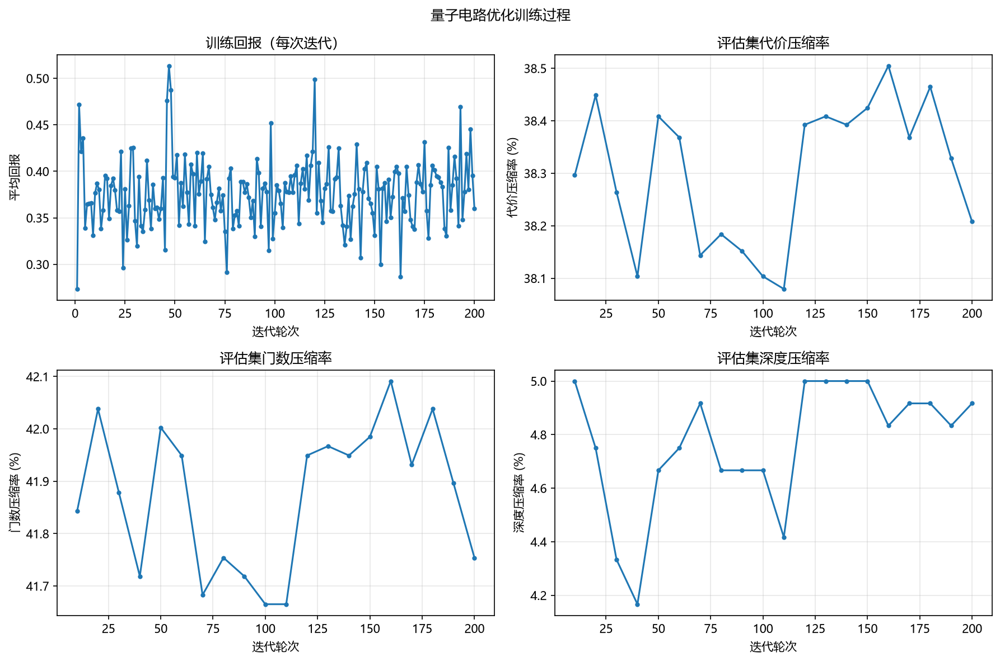
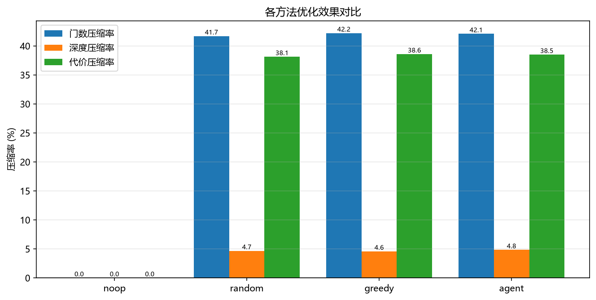
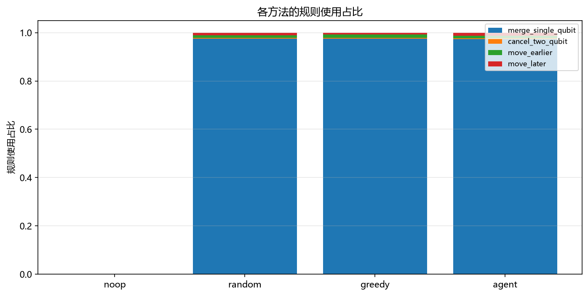
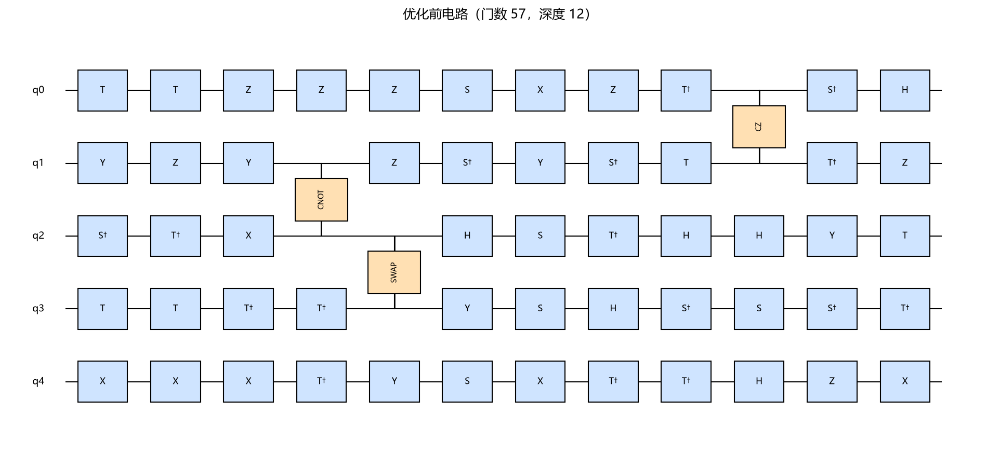
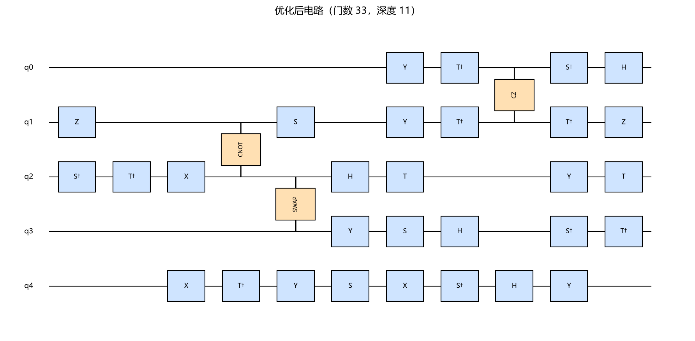

# 基于强化学习的量子电路等价重写优化（毕业设计重写版）

> 用 **PPO + CNN Actor-Critic** 学习“在什么位置执行哪条等价重写规则”，在
> **保持电路语义（幺正矩阵模全局相位）不变** 的前提下，降低量子电路的
> **门数 + λ·深度**。
>
> 本项目是对原毕业设计仓库（代码不可运行、规则在“加门”、PPO 概率计算错误）的**完整重写**：
> 逐文件缺陷分析见 [`PROBLEM_ANALYSIS.md`](PROBLEM_ANALYSIS.md)，方法设计见
> [`docs/design.md`](docs/design.md)，实验协议见 [`docs/experiment.md`](docs/experiment.md)，
> 答辩/速记见 [`docs/defense-notes.md`](docs/defense-notes.md)。

---

## 目录

- [1. 项目背景：原仓库为什么需要重写](#1-项目背景原仓库为什么需要重写)
- [2. 方法总览](#2-方法总览)
- [3. 与原仓库的关键差异](#3-与原仓库的关键差异)
- [4. 环境要求与安装](#4-环境要求与安装)
- [5. 快速开始](#5-快速开始)
- [6. 项目结构](#6-项目结构)
- [7. 实验设置与结果](#7-实验设置与结果)
- [8. 复现说明](#8-复现说明)
- [9. 测试与质量保证](#9-测试与质量保证)
- [10. 文档索引](#10-文档索引)
- [11. 常见问题（FAQ）](#11-常见问题faq)
- [12. 已知局限](#12-已知局限)
- [13. 参考文献](#13-参考文献)

---

## 1. 项目背景：原仓库为什么需要重写

原仓库是一个“PPO + 量子电路”的毕业设计原型：用强化学习在电路上执行若干“规则”来优化电路。
但逐文件审计后发现，它的问题不是“效果不好”，而是**训练闭环在数学上不成立**：

| 原仓库问题 | 后果 |
| --- | --- |
| `rules.py` 的 6 条“规则”全部是往固定比特**添加**固定门（RZ/X/CNOT/SWAP） | 电路语义被改变，不存在“等价优化”；加门只会让目标更差 |
| `environment.py` 状态张量用 `min(n_moments-1, len(circuit))` 作为所有门的时隙索引 | 所有门挤进同一列，时间信息丢失，状态无法表示电路结构 |
| 奖励 `-depth - 0.2*gate_count` 是绝对负代价 | 加门越走越差，“不动”才是最优策略；不同电路之间不可比 |
| `ActionMask.mask()` 直接返回全 `True` | 掩码形同虚设，策略在大量非法动作上浪费概率 |
| 策略网络先 softmax、采样时再归一化、PPO 更新时再做 softmax/exp | 同一动作对应三种分布，`old_log_prob` 与 `new_log_prob` 不可比，PPO 失效 |
| GAE 循环 `range(len(rewards)-1)` 漏掉最后一步 | 最后一步优势恒 0，回报估计有偏 |
| `train.py` 用 `states[step::STEPS_PER_EPOCH]` 切分 | 每批只有 1 条样本，batch 维丢失；`PPO.update` 因 Conv2d 需要 4 维输入而报错 |
| `train.py` 用 `except Exception` 吞掉错误后继续 | 训练“跑完”并保存模型，实际保存的是**随机初始化**权重 |
| `data_generator.py` 调用环境不存在的 `sample_action/step` | 一旦使用必然 `AttributeError`；该文件是死代码 |
| `evaluate.py` 只打印一个负奖励总和 | 没有基线、没有压缩率、没有等价性检查，无法评估优化效果 |
| `problem.md` 对策略维度提出质疑，但结论停留在“换维度顺序” | 没有定位到“归一化范围/采样与 log-prob 分解不一致”的根因 |

> 详细分析（逐文件、带原代码行号引用）见 [`PROBLEM_ANALYSIS.md`](PROBLEM_ANALYSIS.md)。
> 一句话：**原仓库能 import、能打印 “Epoch complete”，但没有真正训练过。**

本重写版的定位不是“提出新算法”，而是：

1. **把系统做对**：正确建模 MDP、正确的等价重写规则、正确的掩码、正确的 PPO；
2. **把系统做全**：数据集 → 环境 → 网络 → PPO → 采样 → 训练 → 基线 → 评估 → 图表；
3. **让结论可信**：每条规则都有语义等价证明与测试，每个实验都有固定种子、日志和基线；
4. **让作者能讲清**：中文文档 + 答辩速记 + 原仓库缺陷分析。

---

## 2. 方法总览

### 2.1 问题定义

给定离散门组成的量子电路 `C`，在保持其幺正矩阵**模全局相位**不变的前提下最小化：

```
cost(C) = num_ops(C) + λ · depth(C),   λ = 0.5
```

这是一个“带语义约束的组合优化”问题，用强化学习学习启发式策略。

### 2.2 MDP

| 要素 | 定义 |
| --- | --- |
| **状态** | `s ∈ R^{14×Q×M}`：11 个门 one-hot 通道 + control + target + idle；`Q=5, M=15` |
| **动作** | `(规则 r, 量子比特 q, 时隙 m)`，`index = (r*Q + q)*M + m`，共 `4×5×15=300` 个 |
| **转移** | 确定性：`s_{t+1} = f(s_t, a_t)`（由规则 `apply` 决定） |
| **奖励** | `r_t = (C_t − C_{t+1}) / C_0`（势函数塑形：每步为正，压缩比例） |
| **终止** | 无可用动作（terminated）或步数达到 `max_steps=48`（truncated） |
| **算法** | CNN Actor-Critic + PPO（GAE、裁剪目标、价值 MSE、熵正则、小批量多轮、KL 早停、梯度裁剪） |

### 2.3 四条等价重写规则（动作空间中的规则下标，禁止调换）

| 下标 | 规则名 | 含义 | 不变量 |
| --- | --- | --- | --- |
| 0 | `merge_single_qubit` | 同一比特相邻两个单比特门相乘，命中门库则合并，等于 `I` 则删除 | 门数 −1/−2，语义等价 |
| 1 | `cancel_two_qubit` | 同一有序比特对上相邻的两个相同自逆门（CNOT/CZ/SWAP）抵消 | 门数 −2，语义等价 |
| 2 | `move_earlier` | 独占时隙的门前移到最早可放置位置 | 深度 −1，语义等价 |
| 3 | `move_later` | 独占时隙的门后移到最晚可放置位置 | 深度 −1，语义等价 |

每条规则都满足：**可适用 ⇒ 应用后 cost 严格下降 + `circuits_equivalent` 为真**。
这是本项目的三条硬不变量（语义保持 / 严格进步 / 动作合法），由测试与评估强制检查。

### 2.4 系统流程

```
随机电路池 ──► CircuitOptimizationEnv（状态张量 + 动作掩码 + 势函数奖励）
                     │
                     ▼
       RolloutCollector：num_envs 个环境并行采样 horizon 步
                     │  (obs, action, log_prob, value, reward, done, mask)
                     ▼
       PPO：逐环境 GAE（含最后一步 + bootstrap）→ 展平 → 小批量多轮更新
                     │
                     ▼
       周期评估（noop / random / greedy / agent）→ best.pt / 日志 / summary.json
                     │
                     ▼
       脚本：make_dataset / train / evaluate / make_figures
```

### 2.5 网络结构

- 输入 `[B, 14, Q, M]`；
- 共享主干：3 层 `Conv2d(3×3)+GroupNorm+ELU`（`H=64`，**无 BatchNorm**）；
- 策略头：`1×1 Conv → logits [B, 4, Q, M]`（**网络内不做 softmax**）；
- 价值头：`1×1 Conv(32) + ELU → Flatten → Linear(32·Q·M,128) + ELU → Linear(128,1)`；
- `act(obs, mask)`：唯一一次 `masked_log_softmax` → 采样/argmax → 返回 `action/log_prob/value/entropy`；
- 默认参数量 **392,165**，CPU 可训练。

> 完整数学定义、规则正确性证明、复杂度分析与设计取舍见 [`docs/design.md`](docs/design.md)。

---

## 3. 与原仓库的关键差异

| 维度 | 原仓库 | 重写版 |
| --- | --- | --- |
| 规则 | 往电路加门，语义改变 | 4 条等价重写规则，逐条证明 + 随机 200 电路测试 |
| 状态 | 时隙索引错误、门类丢失（4 类） | `[14,Q,M]` 张量，显式时隙/控制/目标/空闲，无损编码 |
| 奖励 | 绝对负代价 | 势函数塑形 `(C_t−C_{t+1})/C_0`，每步为正、总回报=压缩比例 |
| 掩码 | 恒全 True | 由规则适用性生成，非法动作概率严格 0 |
| 策略概率 | 双重/三次归一化 | 网络输出 logits + 唯一一次 masked log-softmax |
| GAE | 漏最后一步 | 完整递推 + bootstrap |
| 训练 | 切片错误 + 吞异常，保存未训练模型 | horizon×num_envs 展平 + 小批量多轮；fail loud；产物齐全 |
| 评估 | 只打印总奖励 | 4 种方法 × 8 类指标 + 等价率 + JSON/Markdown |
| 复现 | 无种子、无依赖文件 | 固定种子、配置落盘、`requirements`、数据集 JSON |
| 测试/文档 | 11 个调试 notebook、无断言 | 16 个 pytest 测试文件（含独立审计用例）+ 完整中文文档 |

---

## 4. 环境要求与安装

### 4.1 环境要求

| 项 | 要求 |
| --- | --- |
| 操作系统 | Windows / Linux / macOS（本仓库在 Windows 11 上开发验证） |
| Python | **3.10+**（本仓库虚拟环境为 3.14.7） |
| 核心依赖 | numpy、torch（CPU 版即可）、matplotlib |
| 可选依赖 | cirq（仅用于电路导出/画图/与 numpy 模拟器交叉验证） |
| 硬件 | 普通 CPU 即可；有 GPU 时可 `--device cuda`（不可用时自动回退 CPU） |

### 4.2 安装（Windows PowerShell）

```powershell
cd C:\Users\zjc20\quantum-circuit-optimization

# 核心依赖
C:\Users\zjc20\quantum-circuit-optimization\.venv\Scripts\python.exe -m pip install -r requirements.txt

# 开发/测试依赖（pytest）
C:\Users\zjc20\quantum-circuit-optimization\.venv\Scripts\python.exe -m pip install -r requirements-dev.txt

# 可选：与 Cirq 互操作（不装也能训练/评估，只是 to_cirq/to_text 相关功能不可用）
C:\Users\zjc20\quantum-circuit-optimization\.venv\Scripts\python.exe -m pip install cirq
```

> 没有现成虚拟环境时，可先创建：
> `python -m venv .venv`（然后使用 `.venv\Scripts\python.exe`）。
> CPU-only 的 torch 安装（体积更小）：
> `.venv\Scripts\python.exe -m pip install torch --index-url https://download.pytorch.org/whl/cpu`。

> 项目不强制 `pip install -e .`：所有脚本通过项目根目录直接运行，`pyproject.toml` 仅提供包元数据
> 与 pytest 配置。

---

## 5. 快速开始

> 所有命令都在项目根目录 `C:\Users\zjc20\quantum-circuit-optimization` 下执行。
> 已激活虚拟环境时可用简写 `python`；否则使用完整路径
> `C:\Users\zjc20\quantum-circuit-optimization\.venv\Scripts\python.exe`。

### 5.1 四步跑完整流程

```powershell
# 1) 生成固定评估集：100 个 5 比特、深度 12 的随机电路（seed=10000）
C:\Users\zjc20\quantum-circuit-optimization\.venv\Scripts\python.exe scripts\make_dataset.py --out data\eval.json --count 100 --n-qubits 5 --depth 12 --seed 10000

# 2) 训练 PPO 智能体（150 轮，产物写入 results/default）
C:\Users\zjc20\quantum-circuit-optimization\.venv\Scripts\python.exe scripts\train.py --out results\default --iterations 150 --num-envs 8 --steps-per-iter 16 --seed 0 --device cpu --max-steps 48 --lambda-depth 0.5

# 3) 在评估集上对比 agent 与 random/greedy 基线
C:\Users\zjc20\quantum-circuit-optimization\.venv\Scripts\python.exe scripts\evaluate.py --checkpoint results\default\best.pt --dataset data\eval.json --out results\default\eval --baselines random,greedy

# 4) 生成论文插图
C:\Users\zjc20\quantum-circuit-optimization\.venv\Scripts\python.exe scripts\make_figures.py --run results\default --out results\figures
```

等价的简写（虚拟环境已加入 `PATH`）：

```powershell
python scripts/train.py --out results/default --iterations 150
python scripts/evaluate.py --checkpoint results/default/best.pt --dataset data/eval.json --out results/default/eval --baselines random,greedy
```

根目录的 `train.py` / `evaluate.py` 是 `scripts/` 对应脚本的薄封装，参数完全相同（便于对照原仓库文件名）：

```powershell
python train.py --out results/default --iterations 150
python evaluate.py --checkpoint results/default/best.pt --dataset data/eval.json --out results/default/eval
```

> 上面的快速开始使用**默认的 150 轮**（`docs/architecture.md` 的默认命令，便于先跑通流程）。
> 本报告第 7 节的正式实验使用 `--iterations 200`（8 envs × 16 steps = 25,600 环境步），
> 其余参数相同；两种配置都可用同一套命令复现。

### 5.2 冒烟测试（2 轮，几十秒内完成）

```powershell
C:\Users\zjc20\quantum-circuit-optimization\.venv\Scripts\python.exe scripts\train.py --out results\smoke --iterations 2 --num-envs 2 --steps-per-iter 4 --eval-every 1 --eval-circuits 10 --save-every 1
```

产物应包含 `config.json`、`train_log.csv`、`eval_log.csv`、`best.pt`、`last.pt`、`summary.json`。

### 5.3 训练产物

```
results/default/
├── config.json          # 完整配置（EnvConfig / PPOConfig / TrainConfig）
├── train_log.csv        # 每轮：回报、代价、压缩率、PPO 指标
├── eval_log.csv         # 每次评估：方法、压缩率、等价率、平均步数
├── best.pt              # 评估集 mean_final_cost 最优的模型（含 config）
├── last.pt              # 最后一轮模型
├── checkpoint_0025.pt   # 每 save_every 轮保存的周期检查点（默认 25/50/.../150）
└── summary.json         # 最终四方法对比 + 训练耗时 + 最优轮次 + Markdown 表格
```

评估脚本会额外写入 `results/default/eval/evaluation.json`；图表写入 `results/figures/`。

### 5.4 上手 Notebook

不想直接跑脚本时，可按 [`notebooks/quickstart.ipynb`](notebooks/quickstart.ipynb) 逐格学习：
门库 → 电路 → 模拟器/等价性 → 随机电路 → 观测张量 → 动作编码/掩码 → 规则 → 环境 → 网络前向。
Notebook 为中文、无需 GPU，建议在 Jupyter 中打开后按顺序执行。

---

## 6. 项目结构

```
quantum-circuit-optimization/
├── qco/                         # 核心库（无状态、可测试）
│   ├── __init__.py
│   ├── gates.py                 # 11 个门矩阵、模全局相位匹配
│   ├── circuit.py               # 不可变电路表示、序列化、cirq 互操作
│   ├── simulator.py             # numpy 状态向量/幺正矩阵模拟器、等价性判定
│   ├── observation.py           # 电路 -> [14,Q,M] 观测张量
│   ├── generator.py             # 随机电路生成、数据集 JSON 存取
│   ├── actions.py               # (r,q,m) <-> 一维动作下标的唯一编码
│   ├── rules.py                 # 4 条等价重写规则 + applicable_actions
│   ├── masking.py               # 动作掩码、masked log-softmax / entropy
│   ├── environment.py           # MDP 环境（reset/step/奖励/终止）
│   ├── agent.py                 # CNN Actor-Critic 策略网络
│   ├── ppo.py                   # PPO（GAE、裁剪目标、KL 早停、指标）
│   ├── rollout.py               # 并行轨迹采样（auto-reset、bootstrap）
│   ├── trainer.py               # 训练循环、CSV 日志、checkpoint、summary
│   ├── baselines.py             # noop / random / greedy 基线
│   ├── evaluate.py              # 四种方法的统一评估与 Markdown 表
│   ├── visualizer.py            # 训练曲线、电路图、方法对比、规则使用占比
│   └── utils.py                 # 种子、设备、JSON、目录工具
├── scripts/                     # 命令行入口（argparse，均支持 --help）
│   ├── make_dataset.py
│   ├── train.py
│   ├── evaluate.py
│   └── make_figures.py
├── train.py                     # 根目录薄封装 -> scripts/train.py
├── evaluate.py                  # 根目录薄封装 -> scripts/evaluate.py
├── tests/                       # pytest 测试套件（16 个测试文件 + conftest.py，含独立审计用例）
├── docs/
│   ├── architecture.md          # 团队内部接口契约（实现规范）
│   ├── design.md                # 方法设计（MDP/规则证明/网络/PPO/复杂度/Cirq）
│   ├── experiment.md            # 实验设置、指标、结果表与图
│   ├── defense-notes.md         # 答辩/回忆要点、Q&A
│   ├── audit-report.md          # 独立审计报告（T4，55 个独立用例）
│   └── figures/                 # 论文/README 用图（由 results/figures 复制而来）
├── data/                        # 数据集（data/eval.json 可由脚本重新生成）
├── results/                     # 训练产物与图表（默认不入库）
├── notebooks/
│   └── quickstart.ipynb         # 中文上手 Notebook
├── README.md                    # 本文件
├── PROBLEM_ANALYSIS.md          # 原仓库逐文件缺陷分析
├── requirements.txt
├── requirements-dev.txt
└── pyproject.toml
```

---

## 7. 实验设置与结果

> 完整协议（指标定义、训练配置、结果表、图表说明、复现命令）见
> [`docs/experiment.md`](docs/experiment.md)。

### 7.1 设置摘要

| 项 | 值 |
| --- | --- |
| 电路规模 | 5 比特，初始深度 12，`p_two=0.15` |
| 训练集 / 评估集 | 200 个随机电路（seed=0）/ 100 个随机电路（seed=10000，不重叠） |
| 训练 | **200 iterations × 8 envs × 16 steps = 25,600 环境步**（本次正式实验；默认配置为 150 iterations = 19,200 环境步） |
| 算法 | PPO：`γ=0.99, λ=0.95, ε=0.2, epochs=4, minibatch=64, target_kl=0.02` |
| 设备 | CPU（Windows 11，i5-1035G1） |
| 基线 | `noop`（不动）、`random`（随机合法动作）、`greedy`（一步贪心） |
| 评估 | 每个电路运行四种方法，检查 `circuits_equivalent`，等价率应为 1.0 |

### 7.2 主结果（正式实验）

> 评估集 100 个电路（5 比特、深度 12，seed=10000）；`agent` 为**最优 checkpoint（第 160 轮）**
> 在评估集上的确定性策略结果；等价率全部为 1.00（语义等价）。数据来源：`results/default/summary.json`。

| 方法 | 门数压缩率 | 深度压缩率 | 代价压缩率 | 等价率 | 平均步数 |
| --- | --- | --- | --- | --- | --- |
| `noop` | 0.00% | 0.00% | 0.00% | 1.00 | 0.00 |
| `random` | 41.70% | 4.67% | 38.14% | 1.00 | 18.29 |
| `greedy` | 42.22% | 4.58% | 38.59% | 1.00 | 17.53 |
| `agent` | 42.09% | 4.83% | **38.50%** | 1.00 | 18.65 |

补充：训练到第 200 轮时的 `final_eval` 代价压缩率为 38.21%，best checkpoint 选在第 160 轮
（因此表中 `agent` 取第 160 轮的权重快照）；截断率全部为 0.00，说明没有回合因 `max_steps` 提前结束。
**等价率 1.0 是硬指标**：任何方法只要等价率 < 1.0，说明优化改变了电路语义，该结果整体作废；
本次四种方法均为 1.00，`scripts/evaluate.py` 的 `evaluation.json` 与 `summary.json` 的 agent 行完全一致
（38.50 / 42.09 / 4.83 / 1.00 / 18.65）。

### 7.3 耗时（CPU：i5-1035G1）

| 项 | 值 |
| --- | --- |
| 训练总墙钟时间（200 iterations，CPU） | 986.2 s（约 16.4 分钟） |
| 每轮平均训练时间 | 约 4.9 s |
| 评估 100 个电路：agent | 约 19.0 s（190.3 ms/电路，独立 `evaluate.py` 实测） |
| 评估 100 个电路：random / greedy | 约 18.5 s / 21.2 s |
| 训练期间周期评估的 agent 单电路耗时 | 约 253 ms（与训练进程共享 CPU，仅供参考） |

> 无 GPU 依赖；`--device cpu` 即可完成全部实验。独立评估（`scripts/evaluate.py`）与训练期间
> 周期评估的耗时差异来自 CPU 负载与预热，不影响压缩率指标；
> `scripts/evaluate.py` 在 100 个电路上跑完 4 种方法合计约 **61 秒**。

### 7.4 图表

> 下列图片由 `scripts/make_figures.py --run results/default --out results/figures` 生成，
> 并已复制到 `docs/figures/`（与 README 同仓，GitHub 可直接渲染）。图的坐标轴/单位与
> 图注数字与 `docs/experiment.md` §7 一致。

**图 1：训练曲线**（回报、评估集代价、门数/深度压缩率随迭代变化）



**图 2：方法对比**（noop / random / greedy / agent 的压缩率对比）



**图 3：规则使用占比**（智能体主要使用哪些重写规则）



**图 4：优化前后电路对比**（同一示例电路）





> 图的生成方式与解读见 [`docs/experiment.md`](docs/experiment.md) §7。

### 7.5 结果怎么读（本次实验）

1. **等价率全部为 1.00**：noop/random/greedy/agent 都保持电路语义（模全局相位）不变，优化过程正确；
2. **agent ≈ greedy > random ≫ noop**：代价压缩率 agent 38.50%、greedy 38.59%、random 38.14%、noop 0%；
   agent 与强基线 greedy 只差 0.09 个百分点（门数压缩 42.09% vs 42.22%），但深度压缩略高
   （4.83% vs 4.58%）——说明策略学到了接近一步贪心的行为，这不是失败：在 4 条规则的离散动作空间里，
   一步贪心本身就很强；agent 相对 random 的提升（+0.37 个百分点）说明它确实学到了“选更优动作”；
3. **深度压缩率（约 4.8%）远低于门数压缩率（约 42%）**：`move_earlier/move_later` 要求门独占时隙，
   在默认稠密随机电路上触发很少（规则使用分布见 `docs/experiment.md`），主要收益来自合并/抵消规则；
4. **训练稳定**：首轮 `mean_return` 0.2735、前 20 轮均值 0.3751，后 20 轮均值 0.3871，
   全程范围 0.2735–0.5134；`explained_variance` 从 -4.15 升到 0.87（最后 50 轮均值 0.838），
   `|approx_kl|` 最大 0.0151（未触发 `target_kl=0.02` 早停），策略熵从 2.21 缓慢降到 1.15
   （逐渐确定化）。

---

## 8. 复现说明

### 8.1 可复现性设计

- 所有随机性都由 `seed` 控制：`numpy.random.default_rng`（电路生成）、`set_seed`（训练）、
  `torch.manual_seed`；
- 训练集与评估集使用**不同种子**（0 / 10000），且评估集可固化为 `data/eval.json`；
- `config.json` 记录完整配置；`train_log.csv` / `eval_log.csv` 记录过程；
- `best.pt/last.pt` 保存 `state_dict + config + iteration`，可跨设备加载；
- 环境是确定性的（同一电路 + 同一动作 ⇒ 同一新电路），只有初始电路与策略采样有随机性。

### 8.2 复现步骤

1. 按 [4.2](#42-安装windows-powershell) 安装依赖；
2. 运行 [5.1](#51-四步跑完整流程) 的四条命令；
3. 用 `results/default/summary.json` 核对指标，与 `docs/experiment.md` 的记录表对照；
4. 若要二次验证，重跑同样命令，评估指标应一致（同一硬件/同一依赖版本）。

### 8.3 换配置实验

```powershell
# 换比特数/深度（注意：n_moments 必须 >= initial_depth；旧 checkpoint 不兼容）
python scripts/make_dataset.py --out data/eval_7q.json --count 100 --n-qubits 7 --depth 16 --seed 10000
python scripts/train.py --out results/7q --n-qubits 7 --n-moments 20 --initial-depth 16 --iterations 150 --dataset data/eval_7q.json
python scripts/evaluate.py --checkpoint results/7q/best.pt --dataset data/eval_7q.json --out results/7q/eval

# 换代价函数深度权重（默认 5 比特评估集，可省略 --dataset）
python scripts/train.py --out results/lambda1 --lambda-depth 1.0
```

> **自定义规模必须显式传 `--dataset`**（`scripts/train.py` 新增参数，默认 `data/eval.json`）。
> 否则 Trainer 会读默认的 5 比特评估集，与 7 比特环境维度不一致并报错；
> 评估脚本同样用 `--dataset` 指向对应的评估集。

---

## 9. 测试与质量保证

### 9.1 运行测试

```powershell
C:\Users\zjc20\quantum-circuit-optimization\.venv\Scripts\python.exe -m pytest tests -q
```

当前共 **16 个测试文件**（另有 `conftest.py`）、**237 项测试**，CPU 上整套约 **72 秒**。
其中包括独立审计交付的 `tests/test_audit.py`（55 个对抗性用例，见 [`docs/audit-report.md`](docs/audit-report.md)）。

### 9.2 测试覆盖的关键正确性

| 测试文件 | 保证什么 |
| --- | --- |
| `tests/test_gates.py` | 门矩阵幺正、模全局相位匹配正确 |
| `tests/test_circuit.py` | 电路构造校验、指标、序列化、cirq 往返 |
| `tests/test_simulator.py` | 已知门作用、幺正性、与 cirq 交叉验证（可选） |
| `tests/test_generator.py` | 随机电路深度/合法性/可复现/JSON 存取 |
| `tests/test_rules.py` | **随机 200 电路 × 4 规则：可适用 ⇒ 代价严格下降 + 语义等价 + 电路合法** |
| `tests/test_actions.py` | 动作编码/解码往返与布局一致 |
| `tests/test_observation.py` | 14 通道语义、padding、形状 |
| `tests/test_masking.py` | 掩码与 `applicable_actions` 一致、非法概率为 0、熵无 nan |
| `tests/test_environment.py` | reset/step/奖励公式/done 分类/info/非法动作抛错 |
| `tests/test_agent.py` | 网络形状、掩码采样、deterministic、梯度可反传 |
| `tests/test_ppo.py` | **GAE 与手算参考一致、ratio 初值 1、指标齐全、KL 早停** |
| `tests/test_rollout.py` | 并行采样形状、auto-reset、bootstrap、mask 保存 |
| `tests/test_trainer.py` | 极小配置跑通、产物齐全、checkpoint 可恢复 |
| `tests/test_evaluate.py` | 四种方法评估、等价率 1.0、Markdown/JSON 输出 |
| `tests/test_scripts.py` | 所有 CLI `--help` 可运行 |
| `tests/test_audit.py` | **独立审计用例**：独立参考实现交叉验证门矩阵/嵌入/规则/动作布局/GAE/masked log-softmax，以及端到端 e2e |

### 9.3 独立审计结论

- 独立审计见 [`docs/audit-report.md`](docs/audit-report.md)：**P0 = 0**；P1 = 1（`best.pt`
  权重/元数据不一致，已修复并有回归测试）；P2 = 5（4 项修复、1 项由 `docs/figures/` 补图解决）；
- 审计测试 `tests/test_audit.py` 共 55 个用例，全部随 `pytest tests` 一起运行；
- 关键性质（规则语义等价、代价严格下降、模拟器与 cirq 一致、动作布局、PPO 数学、端到端等价率 1.0）
  均经独立参考实现交叉验证。

另外，`qco/evaluate.py` 在聚合结果时会**主动断言**每个电路优化前后语义等价；
任何规则实现错误都会直接报错而不是悄悄产生错误结论。

---

## 10. 文档索引

| 文档 | 内容 | 适合谁看 |
| --- | --- | --- |
| [`README.md`](README.md) | 总览、安装、快速开始、实验结果、FAQ | 第一次接触项目的人 |
| [`PROBLEM_ANALYSIS.md`](PROBLEM_ANALYSIS.md) | 原仓库 9 个 Python 模块 + `problem.md` 的逐文件缺陷分析 | 想了解“改了什么、为什么”的人 |
| [`docs/design.md`](docs/design.md) | MDP 形式化、4 条规则正确性证明、网络结构、PPO 公式、复杂度、与 Cirq 关系 | 写论文/答辩/代码审查 |
| [`docs/experiment.md`](docs/experiment.md) | 实验设置、指标定义、结果表、图表说明、复现命令 | 跑实验/写实验章节 |
| [`docs/defense-notes.md`](docs/defense-notes.md) | 答辩口述稿、核心速记、Q&A、局限性、复习计划 | 答辩前突击/回忆 |
| [`docs/audit-report.md`](docs/audit-report.md) | 独立审计报告（对抗性测试、P0/P1/P2 结论、冻结快照 SHA256） | 想确认“代码真的对吗”的人 |
| [`docs/architecture.md`](docs/architecture.md) | 团队内部接口契约（类名、函数签名、张量形状） | 维护/扩展代码 |
| [`notebooks/quickstart.ipynb`](notebooks/quickstart.ipynb) | 逐格上手 | 想交互学习核心 API 的人 |

---

## 11. 常见问题（FAQ）

### Q1：没有 GPU 能跑吗？

能。默认 `--device cpu`，项目在 CPU 上完整训练/评估；网络约 39 万参数、每轮仅 128 条样本。
有 GPU 时可传 `--device cuda`，不可用时会自动回退 CPU。

### Q2：torch 安装太慢/太大怎么办？

安装 CPU 版即可：

```powershell
.venv\Scripts\python.exe -m pip install torch --index-url https://download.pytorch.org/whl/cpu
```

### Q3：没装 cirq 会报错吗？

不会。核心训练/评估/模拟器不依赖 cirq；只有 `Circuit.to_cirq()/from_cirq()` 与
`to_text()` 的 Cirq 渲染会抛 `RuntimeError`（提示安装），`to_text()` 会自动回退到自绘 ASCII 图。
建议装 cirq 以获得更好看的电路图和第三方交叉验证。

### Q4：图片里的中文变成方框怎么办？

`qco/visualizer.py` 会自动检测 Windows 常见中文字体（Microsoft YaHei、SimHei 等）；
找不到时**自动回退英文标签**，不会崩溃。想显示中文可安装其中任一字体后重启脚本。

### Q5：训练要跑多久？

取决于机器与配置。本次正式实验（200 轮）在 CPU（i5-1035G1）上实测 **986.2 s（约 16.4 分钟）**，
每轮约 4.9 s；默认 150 轮的配置未单独计时，但同量级更快。先跑 `--iterations 2` 冒烟测试只需几十秒。

### Q6：README/experiment 里的实验数字从哪里来？

来自 2026-10-20 的正式实验 `results/default/`（200 轮、seed=0、评估集 100 个电路、CPU）：
`summary.json` 给出四方法指标与训练耗时，`eval/evaluation.json` 给出独立复评结果，
`train_log.csv`/`eval_log.csv` 给出过程数据。若你重跑实验，请以新的 `summary.json` 为准，
并同步更新本文与 `docs/experiment.md` 的数字。

### Q7：`data/eval.json` 和 `results/` 要提交吗？

不需要，已在 `.gitignore` 中忽略；数据集可由 `scripts/make_dataset.py` 用固定种子重新生成，
训练产物可由 `scripts/train.py` 复现。

### Q8：为什么随机基线（random）有时也能降低代价？

随机基线只从**合法动作**中采样，而每条合法动作都保证严格降低代价，所以它必然有正收益；
区别在于 `random` 不会选择更优的动作顺序，`agent`/`greedy` 应该更接近最优。

### Q9：为什么深度压缩率不高？

`move_earlier/move_later` 要求“该门独占一个时隙”，而默认随机电路每层几乎占满所有比特，
满足条件的门很少；门数压缩主要来自合并/抵消规则。这是规则适用性的结构性现象；
改进方式见“已知局限”。

### Q10：训练效果不如贪心怎么办？

贪心在 4 条规则的离散动作空间上是很强的基线（每步枚举所有合法动作取最优）。
若 agent 接近或略低于 greedy，可以如实分析：规则集小、贪心接近最优、训练样本/轮数有限；
本工作的首要目标是“正确、可复现、可评估的 RL 框架”，性能提升是后续工作。
**不要隐藏基线或只挑种子**。

### Q11：如何增加一条新规则？

1. 在 `qco/rules.py` 实现 `RewriteRule` 子类（`name/description/rule_index/is_applicable/apply`）；
2. 加入 `RULES` 元组（顺序决定动作空间下标）；
3. 在 `tests/test_rules.py` 的随机测试中自动覆盖（cost 严格下降 + 语义等价）；
4. 网络输出形状与动作编码会自动随 `len(RULES)` 变化；
5. 重新训练（旧 checkpoint 的输入/输出维度不兼容）。

### Q12：为什么不用 DQN / A3C / SAC？

- DQN 需要 `max_a Q(s,a)`，与掩码/300 维离散动作结合麻烦，且不直接给出策略分布；
- A2C 每批只用一次，方差大、没有信赖域约束；
- SAC/DDPG 面向连续控制；
- PPO 的“策略分布 + 裁剪 + 多轮小批量”与掩码离散动作天然匹配，实现也足够简单。
详见 `docs/defense-notes.md` §4.1。

### Q13：电路优化会不会改变计算语义？

不会。4 条规则都只做“模全局相位等价”的重写，并有证明与测试保障；评估时每个电路还会用
`circuits_equivalent` 再验证一次，等价率应为 1.0。全局相位不可观测，是量子电路等价的标准定义。

### Q14：为什么状态张量是 14 个通道？

11 个门各一个通道 + control（二比特门控制位）+ target（目标位）+ idle（空闲）。
观测是电路的无损编码（给定 `M ≥ 深度` 可还原电路），因此对策略是马尔可夫充分的。

### Q15：`n_moments` 和 `initial_depth` 的关系？

`n_moments` 是观测窗口宽度，必须 ≥ 电路最大深度（`EnvConfig` 会校验）；
默认 `initial_depth=12 < n_moments=15`，优化后电路变浅也不会改变观测形状。

### Q16：为什么根目录还有 `train.py` / `evaluate.py`？

为了兼容原仓库的使用习惯，它们是 `scripts/` 对应脚本的薄封装，参数完全一致；实际入口推荐
`scripts/` 下的脚本。

### Q17：脚本提示 “No module named qco” 怎么办？

请在**项目根目录**运行，或使用虚拟环境的完整路径：
`C:\Users\zjc20\quantum-circuit-optimization\.venv\Scripts\python.exe scripts\train.py ...`。
脚本会自动把项目根目录加入 `sys.path`，但前提是能找到 `qco/` 包（即从项目内运行）。

### Q18：这个项目联网吗？会安装什么？

运行时不联网；`pip install` 只安装 `requirements*.txt` 中声明的依赖。数据、模型、结果都在本地。

---

## 12. 已知局限

1. **规则集不完备**：只覆盖 4 类离散门的等价重写，不含参数化旋转角合并、三比特门、测量/重置等；
2. **策略局部视野**：3 层 3×3 卷积感受野 7×7，只覆盖 15 个时隙中的一部分；
3. **稠密随机电路上调度类规则触发少**：`move_*` 要求门独占时隙，深度压缩率受限；
4. **固定规模训练**：5 比特、深度 12；换规模需要重新训练（网络输入维度随配置变化）；
5. **未建模真实硬件**：无耦合图/噪声/保真度约束；
6. **未与工业转译器（Qiskit/TKet）全面对比**：基线是 noop/random/greedy，足以验证学习有效性，
   但不是 SOTA 对比。

这些局限已在 `docs/design.md` §15 与 `docs/defense-notes.md` §7 中展开，并给出改进方向。

---

## 13. 参考文献

1. Schulman, J., Wolski, F., Dhariwal, P., Radford, A., & Klimov, O. (2017).
   *Proximal Policy Optimization Algorithms.* arXiv:1707.06347.
2. Schulman, J., Moritz, P., Levine, S., Jordan, M., & Abbeel, P. (2015).
   *High-Dimensional Continuous Control Using Generalized Advantage Estimation.* arXiv:1506.02438.
3. Ng, A. Y., Harada, D., & Russell, S. (1999).
   *Policy Invariance Under Reward Transformations: Theory and Application to Reward Shaping.* ICML.
4. Cirq Developers. (2018). *Cirq: A Python framework for creating, editing, and invoking
   Noisy Intermediate Scale Quantum (NISQ) circuits.*
5. 原毕业设计仓库源码（本仓库的审计对象，见 `PROBLEM_ANALYSIS.md` 的引用索引）。

---

## 许可与致谢

本项目为本科毕业设计重写版，代码与文档用于学习、复现与答辩。项目**未声明开源许可证**
（与原仓库保持一致，避免误授权）；欢迎在保留出处的前提下参考；如用于论文，请引用上列方法文献与 Cirq。
